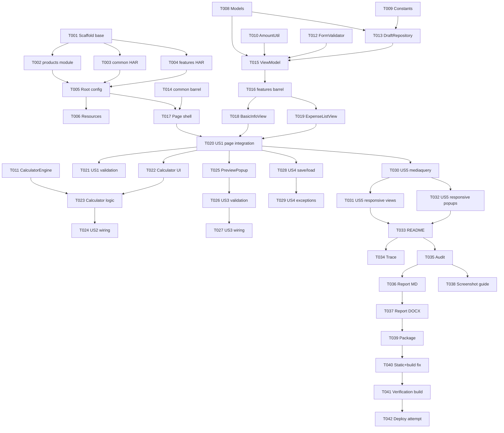

# Tasks: 差旅报销小程序（Assignment 3）

**Input**: Design documents from `spec/business-trip-reimbursement/`  
**Prerequisites**: `plan.md`（必需）、`spec.md`（用户故事与优先级）

**Tests**: 作业未要求单元测试框架，故不生成测试任务；以 `arkts_check` 静态检查 + `devecocli build` 编译作为质量门禁。

**Organization**: 按用户故事分组，确保每个故事可独立实现与验证。

## Format: `[ID] [P?] [Story] Description`

- **[P]**: 可在不同文件中并行执行（无未完成依赖）
- **[Story]**: 所属用户故事（US1–US5）
- 每条任务均包含精确文件路径

## Path Conventions

- 项目根：`/Users/annya/Documents/ustc/harmonyOS/assignment3/`
- 模块：`common/`、`features/`、`products/`（HAR / HAR / entry HAP）
- 资源：`<module>/src/main/resources/base/...`

---

## Phase 1: Setup (Shared Infrastructure)

**Purpose**: 建立三模块工程骨架与构建配置

- [X] T001 使用 `devecocli create` 在临时目录生成 HarmonyOS Stage 工程骨架，并将 `AppScope/`、`hvigor/`、`hvigorfile.ts`、`oh-package.json5`、根 `build-profile.json5` 复制到 `/Users/annya/Documents/ustc/harmonyOS/assignment3/`
- [X] T002 将生成的 `entry/` 改造为 `products/` 模块：`products/build-profile.json5`、`products/hvigorfile.ts`、`products/oh-package.json5`、`products/src/main/module.json5`（type=entry、orientation=auto_rotation）、`products/src/main/ets/productsability/ProductsAbility.ets`
- [X] T003 [P] 创建 `common/` HAR 模块骨架：`common/build-profile.json5`、`common/hvigorfile.ts`、`common/oh-package.json5`（name `@ohos/common`、main `Index.ets`）、`common/src/main/module.json5`（type=har）、`common/src/main/resources/base/element/string.json`
- [X] T004 [P] 创建 `features/` HAR 模块骨架：`features/build-profile.json5`、`features/hvigorfile.ts`、`features/oh-package.json5`（name `@ohos/features`、依赖 `@ohos/common`）、`features/src/main/module.json5`（type=har）、`features/src/main/resources/base/element/string.json`
- [X] T005 在根 `build-profile.json5` 注册 `products`/`common`/`features` 三个模块并统一 `applyToProducts: ["default"]`；在根 `oh-package.json5` 与 `products/oh-package.json5` 建立 `file:` 依赖；设置 `compileSdkVersion`/`compatibleSdkVersion` 为 `6.0.1(21)`
- [X] T006 [P] 归一化资源：`AppScope/app.json5`、`AppScope/resources/base/element/string.json`、`AppScope/resources/base/media/*`、`products/src/main/resources/base/{element/string.json,element/color.json,element/float.json,media/*,profile/main_pages.json}`，删除模板示例页
- [X] T007 [P] 创建交付目录占位：`screenshots/README.md`、`docs/trace/`、`docs/audit/`、`docs/report/`

---

## Phase 2: Foundational (Blocking Prerequisites)

**Purpose**: 领域模型、服务与页面骨架，所有用户故事的前置条件

**⚠️ CRITICAL**: 本阶段完成前不得开始任何用户故事

- [X] T008 [P] 定义领域模型 `ReimbursementForm`、`ExpenseItem`、`DraftRecord`、`OperationResult`、`DraftLoadResult` 于 `common/src/main/ets/model/ReimbursementModels.ets`（含空表单工厂、深拷贝、按 id 替换元素方法）
- [X] T009 [P] 定义常量 `common/src/main/ets/common/AppConstants.ets`：preferences 名称/键、费用类型数组、颜色、间距、弹窗最大宽度、诊断开关文案
- [X] T010 [P] 实现 `common/src/main/ets/service/AmountUtil.ets`：`parse`/`format`/`sumItems`，全部 `try/catch`，非法值抛带中文消息的 `Error`
- [X] T011 [P] 实现 `common/src/main/ets/service/CalculatorEngine.ets`：分词、一元负号、乘除优先、连续运算符覆盖、除零与非法表达式抛错
- [X] T012 [P] 实现 `common/src/main/ets/service/FormValidator.ets`：出差事由必填、至少一条明细、逐条金额 >0、起止日期合法，返回 `OperationResult`
- [X] T013 实现 `common/src/main/ets/data/DraftRepository.ets`：preferences 读写、`flush()`、JSON 强类型编解码（`DraftRaw` → 领域模型，逐字段校验）、三态返回、所有 IO/解析 `try/catch`（依赖 T008、T009）
- [X] T014 编写 `common/Index.ets` 统一导出模型、常量、三个服务与仓储
- [X] T015 实现 `features/src/main/ets/viewmodel/ReimbursementViewModel.ets`：`addItem`/`removeItem`/`updateItemAmount`/`total`/`validate`/`saveDraft`/`loadDraft` 编排（依赖 T008、T010、T012、T013）
- [X] T016 编写 `features/Index.ets` 统一导出 ViewModel 与四个视图组件
- [X] T017 搭建 `products/src/main/ets/pages/Index.ets` 页面骨架：`@Provide('reimbursementForm')`、根 `RelativeContainer`、`List` 容器、`@State isLandscape`、`mediaquery` 注册/注销、`UIContext` Toast 辅助、`forceStorageError` 诊断开关

**Checkpoint**: 三模块可编译，页面可打开，模型/服务可被导入

---

## Phase 3: User Story 1 - 基本信息与费用明细 (Priority: P1) 🎯 MVP

**Goal**: 完成基本信息录入、明细动态增删、实时合计与金额校验

**Independent Test**: 打开应用 → 填写出差事由 → 添加 3 条明细 → 删除 1 条 → 合计正确；非法金额被拒绝并提示

- [X] T018 [US1] 实现 `features/src/main/ets/views/BasicInfoView.ets`：`@Consume` 表单，出差人/部门/事由（TextArea），起止日期行点击回调；行内使用 `Flex`，横屏两列
- [X] T019 [US1] 实现 `features/src/main/ets/views/ExpenseListView.ets`：`@Link newItem` 添加行（类别选择、日期、金额、备注、计算器入口）、明细卡片列表、删除按钮、合计展示；全部行内布局用 `Flex`
- [X] T020 [US1] 在 `products/src/main/ets/pages/Index.ets` 的 `List` 中组装 `BasicInfoView` 与 `ExpenseListView`，实现 `onAddItem`/`onDeleteItem`/日期选择回调，确保 `@Provide/@Consume` 跨模块刷新
- [X] T021 [US1] 在 `ReimbursementViewModel.addItem` 中校验金额，失败时 Toast 中文原因且不追加；合计随明细增删实时更新；空明细显示引导文案

**Checkpoint**: US1 独立可用（MVP）

---

## Phase 4: User Story 2 - 计算器弹窗与回填 (Priority: P2)

**Goal**: 弹窗计算器完成四则运算、小数、清除、退格、结果回填与除零提示

**Independent Test**: 打开计算器 → 100 ÷ 4 = 25 → 确定 → 目标金额框显示 25.00；5 ÷ 0 提示且不崩溃

- [X] T022 [US2] 实现 `features/src/main/ets/views/CalculatorPopup.ets` UI：`@State expression/display/error/justEvaluated`，`Flex` 按键网格，C/⌫/÷/×/−/+/=/小数点
- [X] T023 [US2] 在 `CalculatorPopup.ets` 接入 `CalculatorEngine`：`=` 求值、连续运算符覆盖、单数字多小数点拦截、`try/catch` 转 Toast，错误后保留可继续输入
- [X] T024 [US2] 在 `products/src/main/ets/pages/Index.ets` 接入计算器：`showCalculator`/`calcTargetId` 状态、打开来源（新增行或指定明细）、确定时替换元素对象实现回填、`RelativeContainer` 覆盖层定位与遮罩

**Checkpoint**: US2 独立可用，回填不影响其他明细

---

## Phase 5: User Story 3 - 预览与提交 (Priority: P3)

**Goal**: 预览整单、提交校验、成功清空

**Independent Test**: 完整表单 → 预览内容正确 → 提交成功并清空；事由为空或金额非法时提示且不清空

- [X] T025 [US3] 实现 `features/src/main/ets/views/PreviewPopup.ets`：`@Link form` 只读展示基本信息、明细、合计；`Scroll` 适配长列表；关闭回调
- [X] T026 [US3] 在 `ReimbursementViewModel.validate` 与页面提交逻辑中实现校验顺序（事由 → 明细数 → 金额 → 日期），失败 Toast 具体原因，成功重置表单与新增行草稿
- [X] T027 [US3] 在 `products/src/main/ets/pages/Index.ets` 增加预览/提交按钮与 `PreviewPopup` 覆盖层，确保关闭预览后表单数据不丢失

**Checkpoint**: US3 独立可用，US1+US2 数据被正确汇总

---

## Phase 6: User Story 4 - 临时保存与历史加载 (Priority: P4)

**Goal**: 本地保存/恢复草稿，覆盖空数据、损坏数据、IO 失败三类异常

**Independent Test**: 填写 → 保存 → 修改 → 加载 → 恢复为保存时内容；无历史/损坏时提示且表单不丢

- [X] T028 [US4] 在页面接入 `DraftRepository.save/load`：临时保存、加载历史按钮、成功/暂无/失败 Toast，保存后显示 `savedAt`
- [X] T029 [US4] 处理空数据、JSON 损坏、`flush` IO 异常分支：加载失败不覆盖当前表单；标题长按切换 `forceStorageError` 诊断开关，用于演示存储失败提示

**Checkpoint**: US4 独立可用，异常场景均有中文提示

---

## Phase 7: User Story 5 - 横竖屏自适应 (Priority: P5)

**Goal**: 旋转屏幕后表单与弹窗自动重排且完整可见

**Independent Test**: 竖屏填写 → 旋转横屏 → 字段/按钮/弹窗均可见可点；弹窗不溢出

- [X] T030 [US5] 在 `products/src/main/ets/pages/Index.ets` 完成 `mediaquery` 生命周期管理，将 `isLandscape` 以 `@Prop` 下发所有视图
- [X] T031 [US5] 在 `BasicInfoView.ets`/`ExpenseListView.ets` 使用 `FlexWrap.Wrap` 与百分比宽度实现横屏两列、竖屏单列；长文本自动换行
- [X] T032 [US5] 在 `CalculatorPopup.ets`/`PreviewPopup.ets` 按 `isLandscape` 调整最大宽度、按键尺寸与滚动区域，保证安全区内完整显示

**Checkpoint**: 五个用户故事全部可用

---

## Phase 8: Polish & Cross-Cutting Concerns

**Purpose**: 交付材料、文档、打包

- [X] T033 [P] 编写根 `README.md`：功能说明、目录结构、构建命令、运行方式、诊断开关说明、截图清单
- [X] T034 [P] 生成 `docs/trace/skill-trace.log` 与 `docs/trace/summary.md`：记录本次开发中 `devecocli docs` 查询、`arkts_check`、`devecocli build`、`code_audit` 的调用顺序、入参与结果
- [X] T035 [P] 生成 `docs/audit/code_audit_report.json`：编译/语法/布局/业务四维审计，每项含 `result`、`location`、`evidence`、`suggestion`；同步生成 `docs/audit/fix-list.md` 记录人工修复缺陷
- [X] T036 编写 `docs/report/Assignment3_报告.md`：①设计思路 ②核心模块说明 ③运行截图说明 ④Agent 开发补充 ⑤问题与解决
- [X] T037 使用本地 Python `python-docx` 将报告转换为 `docs/report/Assignment3_报告.docx`
- [X] T038 [P] 完善 `screenshots/README.md`：列出主界面、计算器弹窗、预览弹窗、除零提示、校验失败、存储失败、横屏、竖屏的截图文件名与拍摄步骤
- [X] T039 编写 `scripts/package.sh` 并执行初次打包：排除 `spec/`、`.hvigor/`、`oh_modules/`、`build/`、`.DS_Store`、`dist/`，输出 `Assignment3_TeamX_StudentID1_StudentID2.zip`
- [X] T040 运行 `arkts_check` 全量检查并修复所有 ArkTS 严格模式问题；随后运行 `devecocli build --build-mode debug` 直至成功

---

## Phase 9: Verification

<!-- verification_scope: build-only -->

**Purpose**: 编译与可部署性验证（本次不执行 UI 验证）

- [X] T041 运行 `devecocli build --build-mode debug`，修复所有编译错误与类型错误直至 `BUILD SUCCESSFUL`
- [X] T042 执行 `devecocli run --skip-build` 尝试安装到设备；若当前无设备，记录 `BLOCKED: no connected device` 并在交付说明中标注

---

## Dependencies & Execution Order

- **Setup (Phase 1)**：无依赖，立即开始
- **Foundational (Phase 2)**：依赖 Setup，阻塞全部用户故事
- **User Stories (Phase 3–7)**：依赖 Foundational；按 P1 → P2 → P3 → P4 → P5 顺序推进
- **Polish (Phase 8)**：依赖 US1–US5 完成
- **Verification (Phase 9)**：依赖 Polish 与编译通过

## 📊 Dependency Graph



## ⚡ Parallel Execution Guide

| Phase | Tasks | Required Files | Execution Notes |
|-------|-------|----------------|-----------------|
| Setup | T003, T004 | `common/**`, `features/**` | 两个 HAR 骨架互不依赖，可并行创建 |
| Setup | T006, T007 | resources、docs/screenshots 目录 | 资源归一化与目录占位可并行 |
| Foundational | T008–T012 | `common/src/main/ets/{model,common,service}/**` | 五个独立文件，可并行实现 |
| US1 | T018, T019 | `features/.../views/BasicInfoView.ets`、`ExpenseListView.ets` | 视图互不依赖，可并行 |
| Polish | T033, T034, T035, T038 | `README.md`、`docs/**`、`screenshots/README.md` | 文档类任务可并行 |
| Verification | T041, T042 | 全工程 | 严格串行：先编译成功再尝试部署 |

---

## Parallel Example

```text
# 并行创建两个 HAR 骨架
Task: "T003 创建 common HAR 模块骨架"
Task: "T004 创建 features HAR 模块骨架"

# 并行实现 Foundational 服务
Task: "T010 实现 AmountUtil"
Task: "T011 实现 CalculatorEngine"
Task: "T012 实现 FormValidator"

# 并行实现 US1 视图
Task: "T018 实现 BasicInfoView"
Task: "T019 实现 ExpenseListView"
```

## Implementation Strategy

### MVP First (User Story 1)

1. 完成 Phase 1 Setup + Phase 2 Foundational
2. 完成 US1（T018–T021）
3. **STOP & VALIDATE**：填写/增删/合计/校验
4. 再依次叠加 US2 → US3 → US4 → US5

### Incremental Delivery

- Setup + Foundational → 工程可编译
- +US1 → 可录入与维护明细（MVP）
- +US2 → 金额计算闭环
- +US3 → 可预览与提交
- +US4 → 草稿可恢复
- +US5 → 横竖屏可用
- Polish → 可提交的完整交付包

---

## Notes

- `[P]` 任务仅表示文件不冲突，执行者仍需保证导入路径与导出契约一致
- 所有金额/计算/JSON/列表操作必须 `try/catch`；所有可空访问必须 `?.`/`??`/`??=`
- 每个用户故事完成后先跑 `arkts_check`，再进入下一故事
- 截图由用户在 DevEco Studio 运行后补齐，本计划不生成伪造截图
- 打包 ZIP 使用占位命名，交付前替换团队号与学号

---

## Summary

| 项目 | 数值 |
|------|------|
| 总任务数 | 42 |
| Setup | 7（T001–T007） |
| Foundational | 10（T008–T017） |
| US1 (P1) | 4（T018–T021） |
| US2 (P2) | 3（T022–T024） |
| US3 (P3) | 3（T025–T027） |
| US4 (P4) | 2（T028–T029） |
| US5 (P5) | 3（T030–T032） |
| Polish | 8（T033–T040） |
| Verification | 2（T041–T042） |
| 并行机会 | 15 条 [P] 任务，分布于 Setup/Foundational/US1/Polish |
| 建议 MVP | Setup + Foundational + US1 |
| 验证范围 | build-only（`<!-- verification_scope: build-only -->`） |
